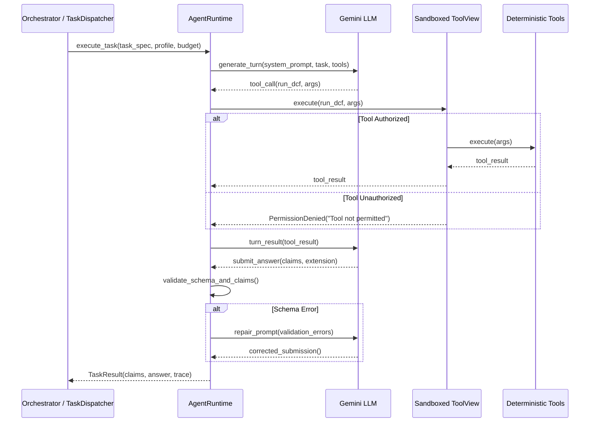

# Lekka AI Architecture Specification

This document provides a comprehensive technical specification of the Lekka AI system architecture, core runtime components, security boundaries, and data pipelines.

---

## 1. System Overview & Core Philosophy

Lekka AI is a multi-agent equity research platform engineered to eliminate financial hallucinations. Standard LLMs frequently invent financial figures, misstate statement dates, confuse GAAP with non-GAAP metrics, and exhibit temporal lookahead bias.

Lekka AI enforces the following core architectural invariants:

1. **Deterministic Grounding**: No financial metric or valuation output may originate from LLM parametric memory. All metrics must be derived via deterministic financial tools or official SEC EDGAR XBRL filings.
2. **Claim Ledger Provenance**: Every statement in a synthesized report is backed by an atomic claim in a shared ledger, referencing an immutable `tool_call_id` and raw tool payload.
3. **Temporal Isolation (`as_of_date`)**: All data retrieval and valuation engines strictly enforce an `as_of_date` boundary, eliminating lookahead leakage.
4. **Deterministic Confidence & Abstention**: Confidence scores (0.0 to 1.0) are calculated via explicit mathematical rules. Any run scoring below 0.60 routes to an abstention report that details missing evidence and guarantees zero fabricated numbers.

---

## 2. High-Level Architecture Diagram

```mermaid
flowchart TD
    subgraph Clients [Clients & Interfaces]
        NextApp[Next.js 16 Web UI<br/>localhost:3000]
        CLI[Typer CLI<br/>lekka-ai ask]
        ExternalAPI[External REST API<br/>POST /runs]
    end

    subgraph Gateway [FastAPI Application Gateway]
        RateLimit[Rate Limiter<br/>Sliding Window per IP]
        Concurrency[Concurrency Gate<br/>MAX_CONCURRENT_RUNS]
        InputValidator[Input Validation<br/>Length, Allowlist, Cost Cap]
        EventBus[Event Bus<br/>SSE /runs/{id}/events]
        Tracer[OpenTelemetry Tracer<br/>GET /runs/{id}/trace]
    end

    subgraph Orchestrator [Multi-Agent Orchestration Pipeline]
        Understand[1. Query Understanding<br/>Intent, Tickers, Ambiguity Check]
        Planner[2. Dynamic DAG Planner<br/>Task Decomposition & Budgets]
        Dispatcher[3. Parallel Task Dispatcher<br/>Wave Scheduling & Worker Concurrency]
        GapChecker[4. Gap Checker & Follow-Up<br/>Multi-Wave Re-planning]
        Verifier[5. Cross-Agent Claim Verifier<br/>Conflict Detection & Number Match]
        Confidence[6. Deterministic Confidence Engine<br/>6 Mathematical Rules]
        Router{Confidence >= 0.60?}
        Synthesizer[7. Report Synthesizer<br/>Strict Ledger Citation Post-Check]
        Abstention[8. Abstention Generator<br/>Missing Data Audit & Zero Numbers]
    end

    subgraph Specialists [Specialist Agent Roster]
        FundAgent[Fundamental Specialist<br/>SEC Filings, XBRL, Statements]
        ValAgent[Valuation Specialist<br/>DCF, Reverse DCF, Multiples]
        MktAgent[Market Specialist<br/>Price Action, Volatility, Beta]
        NewsAgent[News & Catalyst Specialist<br/>8-K Events, Material Catalysts]
        RiskSpecialist[Risk Specialist<br/>Downside Theses, Debt, Red Flags]
    end

    subgraph Harness [Sandboxed Agent Harness]
        ToolView[ToolView Security Proxy<br/>Permission Enforcement]
        RepairLoop[Self-Healing Repair Loop<br/>Pydantic Schema Validation]
        UntrustedSandbox[Untrusted Data Delimiter<br/>Prompt Injection Containment]
        RunBudget[RunBudget Tracker<br/>Tokens, Latency, Hard Cost Cap]
    end

    subgraph DataEngine [Data Adapters & Storage Engine]
        Postgres[(PostgreSQL 16 & pgvector<br/>Runs, Tasks, Spans, Chunks)]
        SecAdapter[SEC EDGAR Client<br/>XBRL Facts, CIK Cache, 10-K/10-Q]
        MarketAdapter[Market Data Adapter<br/>OHLCV Daily Bars & Returns]
        NewsAdapter[News & Estimates Adapters<br/>Finnhub / Tavily / Analyst Consensus]
    end

    Clients --> Gateway
    Gateway --> Orchestrator
    Dispatcher --> Specialists
    Specialists --> Harness
    Harness --> DataEngine
    Orchestrator --> Postgres
    Router -->|Yes| Synthesizer
    Router -->|No| Abstention
    Orchestrator -.-> EventBus
    Orchestrator -.-> Tracer
```

---

## 3. Orchestration Pipeline Stages

### Stage 1: Query Understanding (`understand_query`)
- **Intent Classification**: Evaluates user mandate into intents (`investment_evaluation`, `valuation_check`, `move_explanation`, `risk_review`).
- **Entity & Ticker Extraction**: Resolves target company tickers using an SEC-backed CIK/ticker mapping cache.
- **Ambiguity Detection**: Questions that omit entities, describe ambiguous mandates, or violate the configured ticker allowlist immediately halt with a clarification requirement, preventing ungrounded runs.
- **Point-in-Time Cutoff**: Resolves `as_of_date` (defaults to current UTC date if unspecified).

### Stage 2: Dynamic Planning (`Planner`)
- **DAG Generation**: Constructs a Directed Acyclic Graph (DAG) of specialized subtasks tailored to the classified intent.
- **Dependency Resolution**: Organizes tasks into execution waves (e.g. Fundamental and Market tasks in Wave 1; Valuation tasks depending on financial statements in Wave 2).
- **Budget Allocation**: Splits the overall run budget (tokens, max cost, and runtime seconds) among planned tasks based on computational complexity.

### Stage 3: Task Dispatcher (`TaskDispatcher`)
- **Parallel Asynchronous Scheduling**: Executes independent tasks concurrently using `asyncio.gather`.
- **Worker Isolation**: Each specialist agent runs inside a dedicated `AgentRuntime` instance with a restricted `ToolView`.
- **Fault Tolerance**: Retries transient provider timeouts with exponential backoff while preserving overall deadline constraints.

### Stage 4: Cross-Agent Claim Verification (`Verifier`)
- **Claim Extraction**: Aggregates structured claims emitted by subagents during their submissions.
- **Numerical Cross-Check**: Compares claims across agents to identify inconsistencies (e.g., conflicting revenue or margin numbers reported by different specialists).
- **Conflict Recording**: Unresolved discrepancies are recorded in the ledger and apply a -0.15 confidence penalty.

### Stage 5: Gap Checking & Multi-Wave Re-planning (`GapChecker`)
- **Completeness Assessment**: Verifies whether the collected claims satisfy all dimensions of the research mandate.
- **Follow-up Tasks**: If critical inputs (e.g., cash flow statements for a DCF) are missing, the orchestrator spawns a secondary wave of targeted tasks.

### Stage 6: Deterministic Confidence Scoring (`calculate_confidence`)
Confidence is computed via six explicit mathematical rules:
1. **Fact Proportion**: Ratio of verified facts and calculations to total claims.
2. **Conflict Penalty**: Each unresolved conflict between sources incurs a -0.15 penalty.
3. **Evidence Recency**: Decay applied if filings or prices are stale relative to `as_of_date`.
4. **Background Penalty**: Excessive ungrounded background text lowers confidence.
5. **Agent Role Coverage**: Penalizes runs where expected specialist domains failed to return claims.
6. **Budget Exhaustion**: Deduction applied if the run was truncated due to budget or iteration caps.

### Stage 7: Report Synthesis vs. Abstention
- **Synthesis Path ($\ge 0.60$)**: Generates an equity research report where every sentence must cite supporting claim IDs `[claim_id]`. An automated post-check scans all generated numbers against cited claims, triggering regeneration if ungrounded numbers appear.
- **Abstention Path ($< 0.60$)**: Emits an abstention report listing missing evidence, failing data sources, and recommendations, guaranteeing zero fabricated numbers.

---

## 4. Agent Harness & Runtime Security



### Sandboxed Tool Permissions (`ToolView`)
Agents only receive access to tools declared in their profile (`agents/profiles.yaml`). Attempting to invoke an unauthorized tool raises `PermissionDenied` and is logged as a security event.

| Agent Profile | Authorized Toolsets | Scope |
|---|---|---|
| `analyst` | All financial data, valuation, and news tools | General equity synthesis |
| `valuation` | Financials, market data, DCF, Reverse DCF, Multiples, Scenarios, Python sandbox | Pure quantitative valuation |
| `market` | Market OHLCV, Risk Stats | Technical price action & risk; prohibited from DCF or verdicts |
| `news` | News, SEC filings discovery, filing search | Catalysts & filings; all external text marked untrusted |
| `risk` | Filings, Market OHLCV, Financials, Risk Stats | Downside, duration, debt, contrarian theses |

### Self-Healing Schema Repair Loop
If an LLM produces a malformed tool call or invalid submission schema, the runtime captures the Pydantic validation error, feeds it back to the model with clear repair guidance, and permits up to 3 repair turns before terminating gracefully.

### Untrusted Content Containment
External third-party text (news articles, web scrapes, raw press releases) is automatically sanitized and enclosed in `<untrusted_data>` delimiter tags, neutralizing prompt injection attacks.

---

## 5. Shared Claim Ledger & Evidence Provenance

The Claim Ledger serves as the single source of truth across the lifecycle of a research run.

### Claim Taxonomy
- `fact`: Deterministic data points from official sources (e.g. FY2024 Revenue from 10-K). Must cite a verifiable `tool_call_id`.
- `calculation`: Output of mathematical models (e.g. DCF fair value, beta, WACC). Must cite underlying input facts and model execution.
- `interpretation`: Analytical deduction synthesizing facts or calculations. Must trace back to verified claims.
- `background`: General qualitative context. Bound by length and penalizes confidence if overused.

### Evidence Data Structure
```python
class Evidence(BaseModel):
    source_type: str  # "sec_filing", "market_data", "analyst_estimates", "tool"
    source_id: str  # SEC accession number, filing chunk ID, or tool call ID
    extracted_value: Any  # Raw numeric or string value
    as_of_date: str  # Temporal validity date
    metadata: dict[str, Any] = Field(default_factory=dict)
```

---

## 6. System Hardening & Operational Safeguards

Lekka AI includes production-grade hardening controls:

1. **Sliding-Window Rate Limiting**: Enforced on `POST /runs` per client IP (default: 30 requests/minute). Exceeding clients receive HTTP 429.
2. **Request Question Length Cap**: Maximum 2,000 characters to prevent buffer and context exhaustion attacks.
3. **Ticker Allowlist Validation**: Restricts research runs to pre-approved equity universes when configured, blocking unverified ticker targets.
4. **Run Concurrency Limit**: Limits concurrent active runs (`MAX_CONCURRENT_RUNS`, default: 5). Excess requests receive HTTP 429.
5. **Hard Per-Run Cost Cap**: Enforces a strict ceiling (`HARD_PER_RUN_COST_CAP_USD`, default: $2.00) across token usage and API charges.
6. **Secret Redaction**: Recursively masks credentials, API keys, passwords, and tokens from all structlog outputs and OpenTelemetry trace spans.
7. **Visible Disclaimers**: Injects mandatory regulatory disclaimers (*"Lekka AI is a research tool, not financial advice"*) into all report markdown outputs, API responses, and frontend views.
8. **Fault Injection Security**: Startup validation confirms `FAULT_INJECTION_ENABLED` is strictly disabled outside development/test environments.
