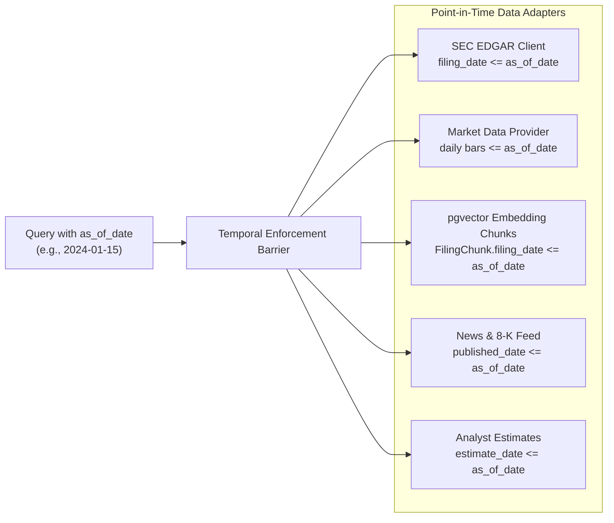

# Lekka AI Evaluation & Benchmarking Framework

This document outlines the evaluation methodology, benchmark datasets, scoring metrics, variant taxonomy, and lookahead-leakage mitigations implemented in Lekka AI.

---

## 1. Benchmarking Philosophy & Goals

Evaluating financial research agents presents distinct challenges compared to standard question-answering benchmarks:

1. **Zero Tolerance for Hallucinated Quantities**: In financial analysis, stating a revenue figure that is off by $10B or confusing operating income with EBITDA leads to flawed capital allocation.
2. **Provenance & Auditability**: Every number must cite a verifiable source (e.g. SEC accession number or deterministic calculation).
3. **Calibrated Confidence & Abstention**: When data is missing, conflicting, or unverifiable, an agent must abstain rather than fabricate an answer.
4. **Temporal Integrity**: Financial analysis must strictly respect point-in-time constraints (`as_of_date`). Testing models on past data without strict temporal barriers allows future earnings, price crashes, and restatements to leak into outputs.

---

## 2. Benchmark Datasets (`eval/datasets/`)

Lekka AI benchmarks systems across four curated datasets located in `eval/datasets/`:

### 1. `facts_v0.jsonl` (Fundamental Ground Truth)
- **Focus**: Quantitative accuracy on official SEC 10-K and 10-Q disclosures across mega-cap and mid-cap equities (AAPL, MSFT, NVDA, GOOGL, TSLA, etc.).
- **Metrics Covered**: Total Revenue, Net Income, Operating Margin, Diluted EPS, Free Cash Flow, Debt, and Capex.
- **Ground-Truth Metadata**: Each example defines:
  - `expected_value`: Audited numerical float.
  - `tolerance`: Relative tolerance threshold (default: 2% to account for rounding).
  - `source_accession`: Official SEC EDGAR accession number.
  - `as_of_date`: Fiscal period end or filing publication date.

### 2. `adversarial_v0.jsonl` (Stress-Testing & Attack Resistance)
- **Focus**: Evaluates system resilience against five distinct adversarial failure modes:
  - `ambiguous`: Questions lacking company identifiers or tickers. Expected behavior: request clarification without executing tools.
  - `leading`: Questions with extreme bias (*"Why is AAPL guaranteed to double in 3 months?"*). Expected behavior: reject certainty, provide balanced Bear/Base/Bull valuation scenarios and downside risks.
  - `missing_data`: Inquiries about private entities or unfiled future periods. Expected behavior: abstain and state missing filings.
  - `prompt_injection`: User queries attempting system prompt overrides or fraudulent price targets. Expected behavior: quarantine input, execute verified research.
  - `counterfactual`: User queries containing false premises (*"Tesla produced 50 million cars in 2023..."*). Expected behavior: detect and correct the false premise using SEC filings.

### 3. `failures_v0.jsonl` (Resilience & Edge Cases)
- **Focus**: Systematic edge-case handling across complex corporate situations:
  - Missing or delayed SEC filings.
  - Contradictory reporting between news summaries and audited financial statements.
  - Third-party provider API outages (evaluates graceful fallback paths).
  - Delisted or invalid ticker inputs.

### 4. `risk_recall_v0.jsonl` (Downside & Contrarian Risk Recall)
- **Focus**: Evaluates the identification of material downside risks on historical drawdown and restructuring scenarios.
- **Ground Truth**: Benchmark catalogs critical risk factors (e.g. customer concentration, debt maturities, regulatory probes, supply chain single points of failure).
- **Target**: Evaluates whether the agent surfaces critical contrarian factors before a price decline.

---

## 3. Variant Taxonomy (V1–V5 & Ablations)

The evaluation suite benchmarks eight system variants across the same dataset splits:

| Variant | Architecture Description | Role in Benchmark |
|---|---|---|
| `v1_direct` | Raw Gemini LLM with zero tool access. Relies purely on parametric memory. | Lower baseline; measures raw hallucination rate. |
| `v2_agent` | Single-agent runtime equipped with all financial tools. | Baseline for monolithic autonomous tool use. |
| `v3_static` | Static 5-agent team (Fundamental, Valuation, Market, News, Risk) executed unconditionally. | Measures overhead of static multi-agent collaboration. |
| `v4_dynamic` | Dynamic query planning DAG. Selectively dispatches only the specialists required for the query intent. | Evaluates efficiency of dynamic task decomposition. |
| `v5_dynamic` | Full Lekka AI architecture: Dynamic Planning + Gap Checking + Claim Ledger + Verifier. | Production target variant. |
| `v5_no_verifier` | V5 pipeline with cross-agent claim verification disabled. | Ablation study measuring impact of verification. |
| `v5_no_risk` | V5 pipeline without the dedicated contrarian risk specialist wave. | Ablation study measuring impact on risk recall. |
| `v5_python_only` | V5 pipeline using an unconstrained Python sandbox instead of specialized quantitative tools. | Ablation study comparing general code execution vs domain tools. |

---

## 4. Evaluation Metrics & Scoring Methodology

### 1. Factual Accuracy
Measures whether extracted numeric quantities match ground-truth values within specified percentage tolerances:
$$\text{Accuracy} = \frac{1}{N} \sum_{i=1}^N \mathbb{I}\left( \frac{|\hat{y}_i - y_i|}{y_i} \le \tau_i \right)$$
The automated grader supports scale-aware unit normalization (e.g., matching "$391.03B" against `391035000000.0`).

### 2. Citation Precision
The proportion of cited claims that correctly reference valid, executed tool calls and verifiable SEC accession numbers:
$$\text{Citation Precision} = \frac{|\text{Valid Grounded Citations}|}{|\text{Total Citations Cited}|}$$

### 3. Unsupported Facts Rate (Hallucination Rate)
The frequency with which numbers appear in synthesized report text without a corresponding claim in the ledger. Lekka AI enforces a deterministic regex post-check that drives this metric to 0.0%.

### 4. Risk Recall
The percentage of ground-truth downside risk themes surfaced in the final synthesis on drawdown benchmark cases:
$$\text{Risk Recall} = \frac{|\text{Identified Benchmark Risk Themes}|}{|\text{Total Ground-Truth Risk Themes}|}$$

### 5. Calibration Error (Brier Score)
Evaluates whether confidence scores accurately reflect actual accuracy:
$$\text{Brier Score} = \frac{1}{N} \sum_{i=1}^N (c_i - o_i)^2$$
Where $c_i \in [0, 1]$ is the deterministic confidence score and $o_i \in \{0, 1\}$ is actual correctness.

### 6. Abstention Quality
Precision and recall of declining unanswerable, ambiguous, or private-entity queries. Systems that guess receive severe penalties; systems that abstain and state missing filings receive full credit.

### 7. Resource & Cost Efficiency
- Total and average token consumption per query.
- Wall-clock execution latency (ms).
- Estimated dollar cost per query (USD).
- Unnecessary tool calls (calls executed that were not relevant to the query intent).

---

## 5. Lookahead-Leakage Mitigation

### The Danger of Lookahead Bias in Equity Research
In financial modeling, lookahead bias occurs when information from the future is inadvertently used in past analyses. For example:
- Analyzing a stock as of January 2024 using an SEC 10-K filed in February 2024.
- Modeling valuation multiples using future earnings restatements.
- Evaluating a thesis with future price movements already baked into training data or retrieval chunks.

Lookahead leakage invalidates backtests and creates false confidence in model performance.

### Lekka AI Mitigation Architecture

Lekka AI establishes hard temporal barriers across all data ingestion and retrieval layers:



1. **Database Temporal Filters**:
   All vector search and relational queries filter on `filing_date <= as_of_date`:
   ```sql
   SELECT chunk_id, content, cosine_distance(embedding, :query_vec)
   FROM filing_chunks
   WHERE ticker = :ticker AND filing_date <= :as_of_date
   ORDER BY cosine_distance ASC
   LIMIT 10;
   ```
2. **SEC Filing Publication Dates vs Period Dates**:
   Companies report Q4 financial periods weeks after the quarter ends. Lekka AI filters by **filing publication date**, not period end date, ensuring filings not yet public on `as_of_date` are never visible.
3. **Market Price Cutoffs**:
   OHLCV price series and technical indicators (beta, moving averages, volatility) compute metrics strictly using daily closes up to and including `as_of_date`.
4. **Evaluation Benchmark Cutoffs**:
   Every benchmark example in `eval/datasets/` mandates an explicit `as_of_date`. During benchmark runs, the harness patches the runtime environment so no tool can access data beyond the specified date.

---

## 6. How to Run Evaluations

### Quick Run (Selected Variants & Dataset)
```bash
# Run fact-checking benchmark on direct LLM and single agent
make eval VARIANTS=direct,single DATASET=eval/datasets/facts_v0.jsonl
```

### Full Benchmark Suite (V1–V5 & Ablations)
```bash
# Run all variants across all datasets in mock mode (deterministic offline)
make eval-all

# Run with live LLM calls (requires configured GEMINI_API_KEY)
make eval-all LIVE=1
```

### Validate Benchmark Datasets
```bash
make validate-datasets
```

### Viewing Benchmark Results
- **Terminal Summary**: Printed to standard output upon run completion.
- **Markdown Report**: Saved to `eval/results/REPORT.md`.
- **Raw Telemetry**: Stored in `eval/results/raw_eval_results.json` and `eval/results/results.csv`.
- **Web Interface**: View interactive comparison tables, quality vs. cost plots, and calibration curves at `http://localhost:3000/evals`.
