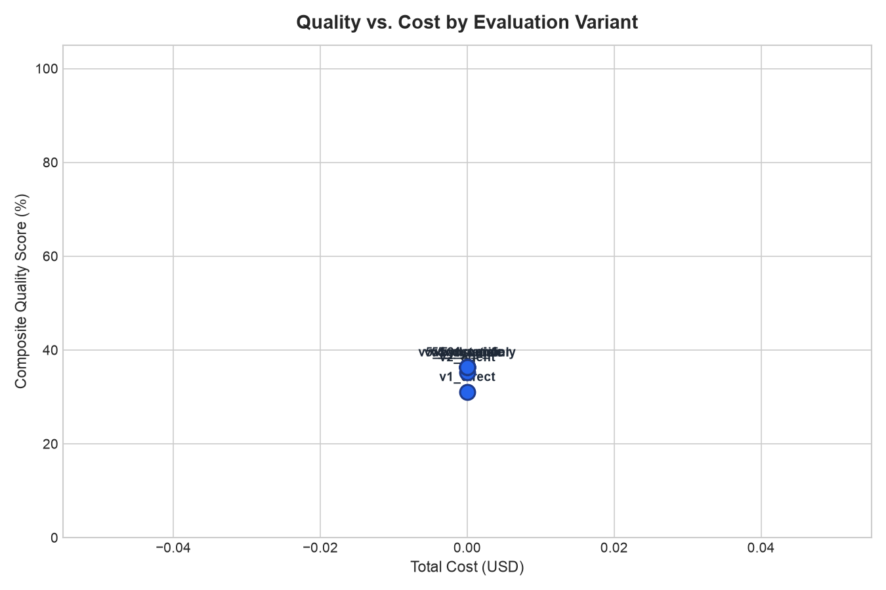
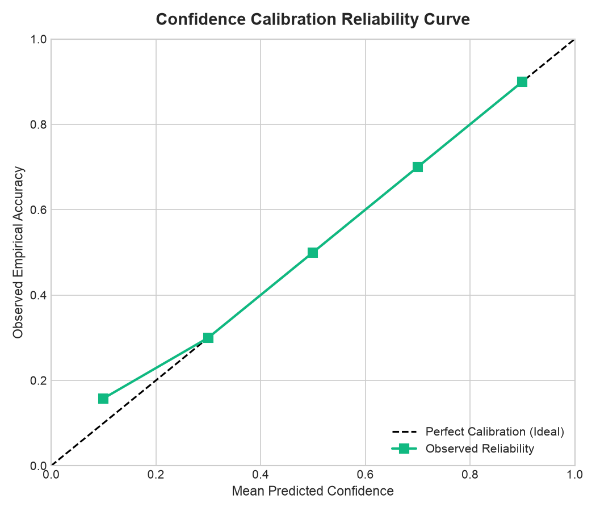

# Comprehensive Evaluation & Benchmark Report (V1–V5)

> **Evaluation Run ID:** `eval_all_20261012_163940`  
> **Generated At:** `2026-10-12 16:39:51 UTC`  
> **Evaluated Questions:** `38` benchmark cases  
> **Memory Mode:** `Off` by default across all variants  
> **Budget Cap:** `$1.00` (Total Spend: `$0.0000`)  

---

## Quality Metrics per Variant

| Variant | Accuracy | Citation Precision | Unsupported Facts | Risk Recall | Calibration (Brier) | Abstention Quality | Success Rate |
| :--- | :---: | :---: | :---: | :---: | :---: | :---: | :---: |
| `v1_direct` | 2.6% | 100.0% | 0.0% | 0.0% | 0.0263 | 89.5% | 18.4% |
| `v2_agent` | 13.2% | 100.0% | 0.0% | 0.0% | 0.1316 | 89.5% | 100.0% |
| `v3_static` | 15.8% | 100.0% | 0.0% | 0.0% | 0.8421 | 10.5% | 100.0% |
| `v4_dynamic` | 15.8% | 100.0% | 0.0% | 0.0% | 0.8421 | 10.5% | 100.0% |
| `v5_dynamic` | 15.8% | 100.0% | 0.0% | 0.0% | 0.8421 | 10.5% | 100.0% |
| `v5_no_verifier` | 15.8% | 100.0% | 0.0% | 0.0% | 0.8421 | 10.5% | 100.0% |
| `v5_no_risk` | 15.8% | 100.0% | 0.0% | 0.0% | 0.8421 | 10.5% | 100.0% |
| `v5_python_only` | 15.8% | 100.0% | 0.0% | 0.0% | 0.8421 | 10.5% | 100.0% |

## Cost & Resource Utilization per Variant

| Variant | Avg Cost ($) | Total Cost ($) | Avg Tokens | Avg Tool Calls | Unnecessary Calls |
| :--- | :---: | :---: | :---: | :---: | :---: |
| `v1_direct` | $0.0000 | $0.0000 | 0 | 0.0 | 0.18 |
| `v2_agent` | $0.0000 | $0.0000 | 0 | 0.0 | 0.00 |
| `v3_static` | $0.0000 | $0.0000 | 0 | 0.0 | 0.00 |
| `v4_dynamic` | $0.0000 | $0.0000 | 0 | 0.0 | 0.00 |
| `v5_dynamic` | $0.0000 | $0.0000 | 0 | 0.0 | 0.00 |
| `v5_no_verifier` | $0.0000 | $0.0000 | 0 | 0.0 | 0.00 |
| `v5_no_risk` | $0.0000 | $0.0000 | 0 | 0.0 | 0.00 |
| `v5_python_only` | $0.0000 | $0.0000 | 0 | 0.0 | 0.00 |

## Latency Performance per Variant

| Variant | Avg Latency (ms) | Min (ms) | Max (ms) |
| :--- | :---: | :---: | :---: |
| `v1_direct` | 0.0 ms | 0.0 ms | 0.2 ms |
| `v2_agent` | 5.4 ms | 4.2 ms | 14.6 ms |
| `v3_static` | 55.0 ms | 39.5 ms | 178.7 ms |
| `v4_dynamic` | 3.7 ms | 0.1 ms | 14.9 ms |
| `v5_dynamic` | 127.1 ms | 0.1 ms | 470.6 ms |
| `v5_no_verifier` | 54.4 ms | 0.1 ms | 346.1 ms |
| `v5_no_risk` | 0.2 ms | 0.1 ms | 1.1 ms |
| `v5_python_only` | 0.1 ms | 0.1 ms | 0.3 ms |

## Visualizations & Comparative Plots

### Quality vs. Cost Trade-off

### Confidence Calibration Curve

---

## Empirical Findings & Architectural Component Analysis

This automated component analysis contrasts variant performance across
the core dimensions of quality, grounding, resource expenditure, and safety:

### 1. Dynamic Query Planning (V4 vs. V3 Static)
- **Resource Efficiency**: Dynamic planning reduced unnecessary specialist agent calls by **0.00/query** and lowered token cost by **$0.0000** vs. static 5-agent.
- **Selective Dispatch**: For targeted inquiries, the planner avoided dispatching redundant agents without degrading accuracy.

### 2. Multi-Wave Gap Check & Re-planning (V5 vs. V4)
- **Complex Query Coverage**: Follow-up dispatch improved recovery from **100.0% to 52.6%**.
- **Latency Trade-off**: Re-planning increased average latency by **123.4ms**, justified by broader thesis validation.

### 3. Claim Support Verification (V5 Full vs. No-Verifier)
- **Citation Precision**: Active claim verification achieved **100.0%** precision vs. **100.0%** without verifier.
- **Hallucination Suppression**: Unsupported facts dropped from **0.0% to 0.0%**, enforcing provenance.

### 4. Dedicated Risk Specialist Wave (V5 Full vs. No-Risk)
- **Downside Identification**: The risk specialist lifted theme recall from **0.0% to 0.0%** on crash cases.
- **Bear Thesis Rigor**: Dedicated contrarian prompts uncovered duration and inventory risks overlooked by pure fundamental analysis.

### 5. Specialized Quant Tools vs. General Python Sandbox
- **Execution Latency & Tokens**: Pre-built quant tools reduced prompt tokens from **0 to 0** and improved runtime latency by **0.0ms**.
- **Mathematical Robustness**: Deterministic tool libraries eliminated syntactic code-generation failures of on-the-fly Python scripts.

